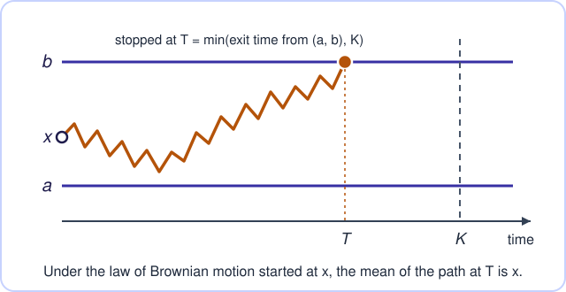

<div align="center">
  
  <h1>MarkovProcess consumer pilot</h1>
  <p><strong>A small Lean 4 project that uses Scott Armstrong's
  <a href="https://github.com/scottnarmstrong/MarkovProcess">MarkovProcess</a>
  library to prove optional stopping for Brownian motion at a truncated exit time.</strong></p>

  <p>
    <a href="https://github.com/chenle02/markovprocess-pilot/actions/workflows/ci.yml"></a>
    <a href="https://github.com/scottnarmstrong/MarkovProcess"></a>
    <a href="lean-toolchain"></a>
    <a href="https://github.com/leanprover-community/mathlib4/tree/065356127b1dc0016f66b7283ce0ce2c4055aa55"></a>
    <a href="docs/reproducing.md#receipts"></a>
    <a href="https://github.com/chenle02/markovprocess-pilot/releases/tag/v0.1.1"></a>
    <a href="https://doi.org/10.5281/zenodo.23452512"></a>
    <a href="LICENSE"></a>
    <a href="https://github.com/sponsors/chenle02"></a>
  </p>

  <p>
    <a href="#what-is-proved"><strong>What is proved</strong></a>
    · <a href="docs/what-is-proved.md">What is proved (for mathematicians)</a>
    · <a href="docs/reproducing.md">Verification and evidence</a>
    · <a href="#build-and-verify">Build</a>
    · <a href="docs/proof-outline.md">Proof outline</a>
    · <a href="#citing">Cite</a>
    · <a href="llms.txt">LLM index</a>
  </p>
</div>

> [!NOTE]
> **Credit: almost all of this is Scott Armstrong's work.** This pilot is a
> thin consumer of Armstrong's
> [MarkovProcess](https://github.com/scottnarmstrong/MarkovProcess)
> (Apache-2.0), which did the heavy lifting. If you use the pilot, please
> [cite MarkovProcess](#citing).
>
> **MarkovProcess supplies:** the canonical Brownian motion
> (`MarkovProcess.brownianMotion`) and its uniqueness; exit times and their
> truncations as stopping times; the heat generator `½ d²` and its domain;
> Feller and Kolmogorov regularity of the heat semigroup; continuous-time
> optional stopping; and Dynkin's formula at a bounded stopping time, the
> expensive part.
>
> **The pilot adds (about 250 lines):** a two-way bridge to Mathlib's
> `IsBrownianReal`, a smooth test function equal to the identity near
> `[a, b]`, two pathwise facts about the exit time, and the final assembly.
> One helper lemma (`mem_of_lt_exitTimeTrunc`) is adapted from MarkovProcess,
> with Armstrong's copyright notice and a statement of the changes. It is a
> pilot, not a general library, and not a new theorem.

## What is proved

<p align="center">
  
</p>

- **Optional stopping at a truncated exit time**
  (`MarkovProcessPilot.integral_eval_exitTimeTrunc_Ioo`). Let $\mathbb{P}_x$ be
  the law of Brownian motion started at $x$ (`MarkovProcess.brownianMotion x`),
  and let $\tau_K$ be the exit time of the path from $(a, b)$, truncated at a
  deterministic horizon $K \ge 0$ (`exitTimeTrunc (Set.Ioo a b) K`). If
  $a < x < b$, then $`\int \omega(\tau_K(\omega))\,\mathbb{P}_x(d\omega) = x`$.

  ```lean
  theorem MarkovProcessPilot.integral_eval_exitTimeTrunc_Ioo
      (a b x : ℝ) (hax : a < x) (hxb : x < b) (K : ℝ≥0) :
      ∫ ω, ω (MarkovProcess.ContinuousPath.exitTimeTrunc (Set.Ioo a b) K ω)
        ∂(MarkovProcess.brownianMotion x) = x
  ```

- **Bridge to Mathlib** (`MarkovProcessPilot.isBrownianReal_iff`).
  `MarkovProcess.IsBrownianReal X P ↔ ProbabilityTheory.IsBrownianReal X P` for
  every process $X$ and measure $P$, so the library's Brownian motion is a
  Brownian motion in Mathlib's sense once recentred at its starting point:
  under $\mathbb{P}_x$, the process $t \mapsto \omega(t) - x$ is
  `IsBrownianReal` (`MarkovProcessPilot.isBrownianReal_brownianMotion`), and
  Mathlib's Brownian API applies to it.

**Mathlib-only statement check.** `lake comparator` confirms that the theorem
`exit_mean` in [`Audit/Exit/Challenge.lean`](Audit/Exit/Challenge.lean),
stated in Mathlib's vocabulary only (any law on `C(ℝ≥0, ℝ)` that is Brownian
started at `x`, with Mathlib's `hittingBtwn` as the stopping time), is
exactly what [`Audit/Exit/Solution.lean`](Audit/Exit/Solution.lean) proves.
The bridge is judged by `exists_unique_brownian_kernel` in
[`Audit/BrownianKernel/Challenge.lean`](Audit/BrownianKernel/Challenge.lean):
exactly one Markov kernel from `ℝ` to `C(ℝ≥0, ℝ)` has a recentred coordinate
process that is `IsBrownianReal` at every starting point. A Mathlib-only
statement cannot name the library's kernel, so the Solution proves this with
`MarkovProcess.brownianMotion` as the witness. `claims.yaml` names the
Challenge theorem that judges each claim (`judged_as`).

The page [docs/what-is-proved.md](docs/what-is-proved.md) puts each result in mathematical
notation beside its Lean statement, with the boundary. The proof route is in [docs/proof-outline.md](docs/proof-outline.md); pins,
axioms and receipts are in [docs/reproducing.md](docs/reproducing.md).

> [!IMPORTANT]
> **Not proved here.** The exit time is **truncated at `K`**. Untruncated exit times,
> and the exit probability `P_x(exit at b) = (x - a)/(b - a)`, are out of scope
> and not claimed. The mathematics is classical; what this repository
> contributes is a machine-checked consumer of MarkovProcess, not a new
> theorem.

## Paper and references

Standalone library; there is no accompanying paper. It is based on:

- Scott Armstrong. *MarkovProcess: sub-Markov kernel semigroups and
  continuous-path Markov processes in Lean 4.* Software, Apache-2.0.
  <https://github.com/scottnarmstrong/MarkovProcess>, used at commit
  [`666cda029098`](https://github.com/scottnarmstrong/MarkovProcess/tree/666cda029098a1106914fc9fa7abd1727573284a).
  It supplies the Brownian motion, exit times, the heat generator, optional
  stopping and Dynkin's formula.
- [Mathlib](https://github.com/leanprover-community/mathlib4), for the
  Brownian-motion API (`ProbabilityTheory.IsBrownianReal`) used by the bridge.

If you use this work, cite MarkovProcess, the preferred citation; see
[Citing](#citing).

## Build and verify

Toolchain Lean `v4.35.0-rc2` ([`lean-toolchain`](lean-toolchain), a prerelease
inherited from MarkovProcess); MarkovProcess
`666cda029098a1106914fc9fa7abd1727573284a` and, through it, Mathlib
`065356127b1dc0016f66b7283ce0ce2c4055aa55`
([`lake-manifest.json`](lake-manifest.json)).

```bash
git clone https://github.com/chenle02/markovprocess-pilot.git
cd markovprocess-pilot
lake update                         # once; fetches packages and the Mathlib cache
lake exe cache get                  # Mathlib oleans (no-op if already fetched)
lake build                          # builds MarkovProcess from source, then the pilot
lake env lean scripts/Axioms.lean   # prints the axioms of the main declarations
```

MarkovProcess ships no olean cache, so its 250 modules compile on the first
build: about 3.5 minutes on 4 cores and 1.5 GB peak memory per process
([measured](docs/reproducing.md#build-cost-measured-on-a-laptop-2026-10-05)).
`lake build Audit` builds the comparator challenge and solution.

To use the pilot from another Lake project:

```toml
[[require]]
name = "MarkovProcessPilot"
git = "https://github.com/chenle02/markovprocess-pilot.git"
rev = "v0.1.1"
```

then `import MarkovProcessPilot`. This also brings in MarkovProcess at the
pinned commit; the consuming project must use the same Lean toolchain,
`leanprover/lean4:v4.35.0-rc2`.

## Trust and axioms

| Check | Status |
|---|---|
| Build | `lake build` green at Lean `v4.35.0-rc2`, Mathlib `065356127b1d` |
| Placeholders | no `sorry`, `admit`, custom `axiom` or `native_decide` in `MarkovProcessPilot/` |
| Axioms | `propext`, `Classical.choice`, `Quot.sound` only ([`logs/axioms.txt`](logs/axioms.txt)) |
| Comparator | `pass`, toolchain mechanism; con-ron, NanoDa and Lean kernels |
| Receipts | [`.lean-receipts/`](.lean-receipts/), bound to commit [`1548828e63c8`](https://github.com/chenle02/markovprocess-pilot/tree/1548828e63c86f2c3f360ac46ab91ec78ba45276) |
| Index | listed in the lean-pkg package index at that pin, trust level `comparator` |

The comparator receipt covers three configurations in
[`comparator/`](comparator/): `exit_mean`, `exists_unique_brownian_kernel` and
a toolchain smoke test (`two_mul_le`, in [`Audit/Smoke/`](Audit/Smoke/)), each
with permitted axioms `propext`, `Quot.sound` and `Classical.choice`. The
`sorry` in each `Audit/*/Challenge.lean` is intentional: those files hold the
statements only, and the comparator checks each against its `Solution.lean`.
Details: [Axioms and placeholders](docs/reproducing.md#axioms-and-placeholders)
and [Receipts](docs/reproducing.md#receipts).

## Built with lean-pkg

Developed and verified with [lean-pkg](https://github.com/lean-pkg/lean-pkg) ([doi:10.5281/zenodo.23272098](https://doi.org/10.5281/zenodo.23272098)).
The receipts were made with lean-pkg 0.14.0
([doi:10.5281/zenodo.23445755](https://doi.org/10.5281/zenodo.23445755)); the
build receipt and the comparator receipt under
[`.lean-receipts/`](.lean-receipts/) bind the checks above to source commit
`1548828e63c8`.

## Authors and AI disclosure

Le Chen, Associate Professor,
Department of Mathematics and Statistics, Auburn University.

The mathematics formalised here, and nearly all of the Lean, come from Scott
Armstrong's [MarkovProcess](https://github.com/scottnarmstrong/MarkovProcess);
the pilot depends on it and on Mathlib, both Apache-2.0, and adapts one lemma
from MarkovProcess with Armstrong's notice.

Developed with AI assistance (Anthropic Claude) under Le Chen's direction.
Lean compilation, the axiom check and the comparator check the stated theorems
only; AI assistance is not human mathematical review.

## Find your way

| You want to | Go to |
|---|---|
| Understand the proof and what came from MarkovProcess | [docs/proof-outline.md](docs/proof-outline.md) |
| Rebuild, check pins, axioms and receipts | [docs/reproducing.md](docs/reproducing.md) |
| Read the Lean source | [`MarkovProcessPilot/BrownianExit.lean`](MarkovProcessPilot/BrownianExit.lean) |
| Machine-readable claims | [`claims.yaml`](claims.yaml) |
| Point a coding agent at the repository | [`llms.txt`](llms.txt) and [`AGENTS.md`](AGENTS.md) |
| Report a problem | [open an issue](https://github.com/chenle02/markovprocess-pilot/issues/new/choose) |

## Repository map

| Path | Contents |
|---|---|
| [`MarkovProcessPilot/BrownianExit.lean`](MarkovProcessPilot/BrownianExit.lean) | the bridge and the exit-time theorem |
| [`MarkovProcessPilot.lean`](MarkovProcessPilot.lean) | umbrella import |
| [`Audit/Exit/`](Audit/Exit/) | comparator statement (Mathlib only) and its proof |
| [`Audit/BrownianKernel/`](Audit/BrownianKernel/) | comparator statement for the bridge (Mathlib only) and its proof |
| [`Audit/Smoke/`](Audit/Smoke/), [`comparator/`](comparator/) | comparator smoke test and configurations |
| [`scripts/Axioms.lean`](scripts/Axioms.lean) | `#print axioms` for the main declarations |
| [`.lean-receipts/`](.lean-receipts/) | lower-tier and comparator receipts, bound to source commits |
| [`claims.yaml`](claims.yaml) | machine-readable claims (schema `claims/1`) |
| [`logs/`](logs/) | build, cache and axiom logs |
| [`docs/`](docs/) | proof outline, reproduction notes, images |

## Citing

This pilot is a thin layer over Scott Armstrong's MarkovProcess, which did the
hard part. If you use it, please cite **MarkovProcess** as its
[`CITATION.cff`](https://github.com/scottnarmstrong/MarkovProcess/blob/main/CITATION.cff)
asks:

> Scott Armstrong. *MarkovProcess: sub-Markov kernel semigroups and
> continuous-path Markov processes in Lean 4.* Software, Apache-2.0.
> <https://github.com/scottnarmstrong/MarkovProcess>

This repository's [`CITATION.cff`](CITATION.cff) names MarkovProcess as the
preferred citation, so GitHub's "Cite this repository" button shows it, and
lists it under `references` at the pinned commit `666cda029098`. To refer to
the pilot itself, cite release
[`v0.1.1`](https://github.com/chenle02/markovprocess-pilot/tree/v0.1.1),
archived on Zenodo as
[doi:10.5281/zenodo.23452512](https://doi.org/10.5281/zenodo.23452512)
(all versions: [doi:10.5281/zenodo.23452511](https://doi.org/10.5281/zenodo.23452511));
its Lean source is the source at commit `1548828e63c8` that the receipts cover
(`v0.1.1` changes documentation only).

## Acknowledgments

The mathematics formalised here, and nearly all of the Lean, come from Scott
Armstrong's [MarkovProcess](https://github.com/scottnarmstrong/MarkovProcess).
Mathlib supplies the Brownian-motion API used by the bridge.
Developed and verified with [lean-pkg](https://github.com/lean-pkg/lean-pkg) ([doi:10.5281/zenodo.23272098](https://doi.org/10.5281/zenodo.23272098)); the receipts were made with lean-pkg 0.14.0 ([doi:10.5281/zenodo.23445755](https://doi.org/10.5281/zenodo.23445755)).

## Support

If this work is useful to you, you can
[sponsor Le Chen on GitHub](https://github.com/sponsors/chenle02).
Sponsorship does not change what is claimed here or how it is checked. To
support MarkovProcess, star and cite
[Armstrong's repository](https://github.com/scottnarmstrong/MarkovProcess).

## License

Apache-2.0, see [`LICENSE`](LICENSE). MarkovProcess (Apache-2.0, Scott
Armstrong) and Mathlib (Apache-2.0) are dependencies, not vendored, except one
lemma adapted from MarkovProcess (`mem_of_lt_exitTimeTrunc`; its notice is in
[`MarkovProcessPilot/BrownianExit.lean`](MarkovProcessPilot/BrownianExit.lean)).

Maintained by [Le Chen](https://webhome.auburn.edu/~lzc0090/), Department of
Mathematics and Statistics, Auburn University.
